# 高校后勤服务管理系统的实现、漏洞验证与安全加固研究

## 摘要
本文以当前代码仓库中的 UniMan 项目为研究对象，围绕高校后勤服务场景，对系统的真实实现方式、业务模块、认证授权机制以及安全缺陷进行系统分析，并在同一仓库中对漏洞版与加固版进行对照研究。项目仓库并非抽象示例，而是包含 `with-vuln` 与 `without-vuln` 两套可运行实现，其中前端均采用 Vue 3 与 Vite，后端均采用 FastAPI，数据持久化层使用 SQLite。系统面向普通用户、后勤人员和系统管理员三类角色，提供报修、投诉建议、公告通知、用户管理、角色管理、基础数据维护和服务评价等功能。与常见毕业论文中“先设计再假设实现”的写法不同，本文首先依据代码文件、数据库表结构、接口逻辑和前端页面行为还原系统真实形态，再据此完成系统实现说明、安全分析和加固设计。

在系统实现部分，本文从前后端分离单体架构出发，详细分析登录页面、用户门户、后台看板、报修管理、投诉建议管理、公告管理、用户管理等关键页面的实现方式，说明前端如何通过 Vue Router 构建角色分流，如何利用 Axios 完成接口调用，如何通过 `ref`、`reactive` 与 `localStorage` 保存会话状态；同时分析后端在 `app/main.py` 中集中实现控制入口、业务处理与数据访问的结构特征，解释登录接口、工单接口、公告接口、投诉接口和用户接口的处理流程，并据 `init_db()` 中的真实建表语句给出数据库设计表。研究表明，该项目虽然功能完整、业务链条清晰，但漏洞版实现存在多项高风险安全问题，其中最突出的包括字符串拼接登录查询导致的 SQL 注入、服务端未鉴权导致的敏感接口裸露、越权修改他人资料与业务数据、明文密码泄露以及上传与跨域配置过宽等问题。

在漏洞分析与验证部分，本文采用代码审计、接口调用、浏览器访问和 Playwright 自动化相结合的方法完成验证。实验结果表明，攻击者可在漏洞版登录页通过 SQL 注入绕过认证并直接进入管理员后台，可未登录访问 `/api/users` 获取所有账号及明文密码，可通过 `/api/profile/{user_id}` 重置他人密码并接管账号，还可直接调用 `/api/notices` 发布未授权公告。与此同时，针对 XSS 与 CSRF 进行了专项分析。由于前端页面未使用 `v-html` 等危险渲染方式，Vue 模板默认会对插值内容进行转义，因此在当前代码基线下未形成可执行的 XSS 利用链；又由于漏洞版多数接口本身缺少服务端鉴权，经典基于 Cookie 的 CSRF 在该项目中并非主要矛盾，其风险被“未鉴权即可直接调用接口”的问题所覆盖。加固版则通过参数化查询、PBKDF2 密码哈希、Bearer Token、后端角色校验、数据范围控制、上传限制和收紧 CORS 等方式完成修复。对照验证结果表明，加固版能够阻断相同攻击请求并返回 401 或 403。

本文的研究价值在于证明：在中小型 Web 系统中，安全问题并不一定来自复杂框架或中间件，很多高危漏洞直接来源于开发阶段将“前端路由限制”误当作“服务端权限控制”，或将“能运行”误当作“可交付”。通过对同仓库漏洞版与加固版的并置分析，本文给出了一个适用于本科毕业设计写作的完整案例：既覆盖系统实现，也覆盖漏洞验证与安全加固，且全部结论均基于真实代码与真实运行结果。

关键词：高校后勤服务管理系统；Vue 3；FastAPI；SQLite；SQL 注入；越权访问；安全加固

## Abstract
This thesis investigates the UniMan project in the current repository and presents a code-based study on system implementation, vulnerability verification, and security hardening. The repository contains two runnable versions of the same system, namely `with-vuln` and `without-vuln`, which makes it possible to compare insecure and hardened implementations under the same business context. The frontend is built with Vue 3 and Vite, the backend is implemented with FastAPI, and SQLite is used as the persistence layer. The system serves three kinds of roles, including ordinary users, logistics workers, and administrators, and provides repair submission, complaint management, notice publishing, user management, role management, base data maintenance, and service evaluation.

Unlike template-style undergraduate theses that describe an imagined implementation, this work starts from the actual source code, the database schema, the HTTP interfaces, and the frontend interaction flow. The implementation chapter explains how the login page, user portal, dashboard, repair module, complaint module, notice module, and user module are built in the Vue application, how Axios is used to invoke backend APIs, and how session state is stored on the client side. On the backend side, this thesis analyzes the centralized structure of `app/main.py`, where controller entry points, business rules, and SQL operations are implemented together, and further describes the design of the core tables extracted from the real `init_db()` procedure.

Security analysis reveals several high-risk issues in the vulnerable version. These issues include SQL injection in the login query, plaintext password exposure, unauthenticated access to sensitive APIs, horizontal and vertical privilege escalation, weak business state control, unrestricted file upload behavior, and overly permissive CORS configuration. The vulnerabilities are verified by code inspection, HTTP requests, browser-based access, and Playwright automation. The results show that an attacker can bypass authentication through SQL injection, access `/api/users` without logging in to obtain all account records with plaintext passwords, modify another user's profile and password through `/api/profile/{user_id}`, and create unauthorized notices by directly calling the notice API. In contrast, the hardened version blocks the same attack requests with parameterized queries, password hashing, bearer-token authentication, backend authorization guards, scoped data access, and file type restrictions.

This thesis demonstrates that, in small and medium-sized web applications, severe security vulnerabilities often originate from basic engineering mistakes rather than from complicated infrastructure. The comparison between the vulnerable and hardened versions provides a complete, real-code case for an undergraduate final thesis, covering system implementation, vulnerability exploitation, and secure redesign in an integrated manner.

Key Words: campus logistics system; Vue 3; FastAPI; SQLite; SQL injection; privilege escalation; security hardening

## 1 绪论
高校后勤服务管理场景具有典型的流程驱动特征。学生或教师在日常学习、住宿和公共空间使用过程中会产生报修、投诉、建议和通知阅读等事务需求；后勤人员需要跟踪工单、反馈处理结果；系统管理员则需要在用户、角色、公告和基础数据等层面统一维护业务运行秩序。因此，一个高校后勤服务系统通常同时具备面向终端用户的自助服务入口和面向管理人员的后台业务入口，其核心价值并不只是“把表单放到网页上”，而是将角色分流、状态流转、数据记录与权限控制整合到统一业务链条之中。

当前仓库中的 UniMan 项目恰好具备这一特征。项目以同一业务域为基础，分别提供漏洞研究版 `with-vuln` 和安全加固版 `without-vuln`。这意味着本文不仅能够描述系统“如何实现”，还能够回答“为什么这种实现会产生漏洞”以及“如何在真实代码上修复漏洞”。这一点使本文区别于停留在界面展示或概念设计层面的常规论文写法，也使其更接近真实软件工程交付。

从研究问题来看，本文主要聚焦三个方面。第一，系统在真实代码中的业务结构、技术栈、数据库设计和前后端交互方式是什么。第二，漏洞版系统在哪些环节存在身份认证、权限控制、业务逻辑与配置安全问题，这些问题能否通过实际运行和自动化工具验证。第三，加固版系统使用了哪些具体策略阻断上述风险，其修复效果如何。在这一框架下，论文的目标不只是完成一篇“介绍系统功能”的毕业论文，而是提交一份兼顾实现细节、安全研究与工程验证的完整终稿。

本文的研究方法主要包括四类。其一是静态代码分析，即对项目目录结构、前端页面、后端接口、数据库初始化语句和会话处理逻辑进行逐文件审计。其二是动态接口验证，即使用 HTTP 请求对关键漏洞进行复现和比对。其三是浏览器自动化验证，即使用 Playwright 对登录绕过、后台访问和越权调用形成可视化证据。其四是对照法，即将漏洞版与加固版在同一业务场景下进行横向比对，从而使“问题”与“修复”能够形成一一映射关系。

## 2 相关技术介绍
本项目前端采用 Vue 3 与 Vite 技术栈实现。Vue 3 提供了组合式 API，使页面状态能够通过 `ref` 和 `reactive` 方式进行组织。项目中无论是登录页、用户门户还是后台管理页面，都没有引入 Pinia 或 Vuex 一类的全局状态管理库，而是以页面局部状态加上 `localStorage` 会话存储的方式维持运行。这种实现方式降低了项目复杂度，但同时也将会话安全问题直接暴露出来，因为一旦会话对象设计不当，敏感信息就容易被前端持久化。Vite 则承担前端开发服务器和构建任务，`vite.config.js` 中通过 `/api` 反向代理与 FastAPI 后端联调。

后端采用 FastAPI 框架构建 REST 接口。FastAPI 的优势在于使用 Python 类型标注和 Pydantic 模型即可完成较为清晰的参数校验和接口定义。在本项目中，`with-vuln/backend/app/main.py` 与 `without-vuln/backend/app/main.py` 都将 `LoginPayload`、`RepairPayload`、`ComplaintPayload`、`NoticePayload`、`UserPayload` 等请求模型定义在同一文件中，并通过 `@app.get`、`@app.post`、`@app.put`、`@app.delete` 对外暴露接口。漏洞版与加固版的主要差异不在框架本身，而在具体安全使用方式，例如是否使用参数化查询、是否校验 Token、是否按角色限制接口访问。

数据库层采用 SQLite 实现。SQLite 具有轻量、零部署、文件型存储的优点，适合教学场景和中小型业务原型。项目通过 `sqlite3.connect(DB_PATH)` 建立连接，并在 `init_db()` 中直接执行建表与初始化数据逻辑。这种设计非常利于论文分析，因为表结构、种子数据和状态枚举都集中在单一函数中，便于从真实代码中抽取数据库设计与业务初始状态。与此同时，SQLite 也放大了“原生 SQL 书写习惯”对安全性的影响，例如在漏洞版登录接口中使用字符串拼接时，注入缺陷表现得非常直接。

在安全机制层面，漏洞版与加固版形成了鲜明对比。漏洞版登录接口直接拼接 SQL，前端在 `localStorage` 中保存包含明文密码的会话对象，后台绝大多数接口未引入任何身份校验。加固版则使用 PBKDF2 哈希存储密码，引入基于 `HTTPBearer` 的 Token 验证，通过 `current_session()` 取得当前会话，并用 `require_roles()` 对系统管理员权限进行约束。前端对应地通过 Axios 请求拦截器自动附加 `Authorization: Bearer <token>` 头部。这种对比使项目具备了良好的教学研究价值，因为同一业务需求下两种实现方式的安全后果截然不同。

## 3 可行性分析
从技术可行性看，该系统具备完整的运行条件和较低的工程复杂度。项目依赖仅包含 `fastapi`、`uvicorn`、`python-multipart` 等基础后端库，以及 `vue`、`vue-router`、`axios`、`vite` 等基础前端库，能够在普通开发环境中直接启动。数据库不依赖独立服务，而是以 SQLite 文件形式随项目存在，这使得系统易于部署、测试和还原。对毕业设计而言，这种轻量化架构有利于将研究重点集中在系统逻辑和安全问题本身，而不是被复杂运维环境牵制。

从业务可行性看，高校后勤服务是一个真实且稳定的应用场景。项目中的“报修、投诉建议、公告通知、用户角色、基础数据、服务评价”六类核心对象均能对应高校日常管理需求。普通用户关注的是问题提交、状态跟踪和通知接收；后勤人员关注的是工单确认、处理、退回和结果反馈；系统管理员关注的是用户治理、角色配置、公告发布和基础数据维护。项目代码中的路由划分、菜单配置、工单状态以及公告发布范围都与这一业务场景保持一致，因此系统具备较强的现实指向性。

从论文写作可行性看，本项目有两个明显优势。其一，系统实现较为集中，便于从真实代码中提取论文章节素材。例如数据库、接口和种子数据都集中在 `main.py` 中，前端页面按功能拆分为独立 `.vue` 文件，路由、认证、接口封装分别位于 `router/index.js`、`auth.js`、`api.js` 中，便于构建从页面到接口再到数据层的完整叙述链。其二，项目同时提供漏洞版与加固版，可天然支撑“系统实现 + 漏洞验证 + 安全加固”的毕业论文结构，不需要为了安全章节再额外虚构实验对象。

从风险可行性看，系统也存在明显不足。漏洞版将业务层、数据访问层和接口层全部放在单一文件中，可维护性一般；前端虽实现了角色分流，但大量关键约束没有下沉到后端；数据库未建立严格的外键与复杂约束；日志体系仅能记录简单操作信息。这些问题正是后文需要分析和修复的重点。换言之，该项目不仅“可做”，而且“有问题可做”，这使其很适合作为本科毕业论文的研究对象。

## 4 需求分析
根据代码仓库中的页面、路由与接口设计，可以将系统需求归纳为三类角色需求。普通用户需要在统一门户中完成登录、查看首页概览、提交报修、编辑或取消未结束工单、提交投诉建议、查看公告和对已完成工单进行评价。后勤人员需要登录后台后查看分派给自己的工单、确认接单、填写处理结果、在必要时退回工单，并查看整体业务看板。系统管理员需要在后台对所有工单、投诉建议、公告、用户、角色和基础数据进行维护，并查看统计概览。项目路由已经明确体现了这种需求结构，例如 `with-vuln/frontend/src/router/index.js` 中将普通用户路由映射到 `/user/*`，将后勤人员和管理员引导到 `/admin/*`。

系统的功能性需求可以进一步拆解。报修模块要求用户选择报修类型、校区、楼栋、房间并提交问题描述，系统需要生成工单号并记录处理状态；投诉建议模块要求用户提交标题、类型和内容，管理员后续可进行回复；公告模块要求管理员维护公告标题、内容、状态与发布范围，普通用户和后勤人员按角色查看与自己有关的已发布公告；用户、角色与基础数据模块要求管理员能够执行增删改查操作；评价模块要求用户对已完成工单进行评分与文字评价。所有这些需求都在代码中对应到真实接口与页面，而不是设计稿中的假设功能。

非功能性需求方面，项目至少需要满足易用性、响应性与安全性要求。易用性体现在前端将普通用户门户与后台工作台分开设计，避免终端用户进入表格化管理页面；响应性体现在所有列表和弹窗交互都以异步请求完成，前端构建体量较小；安全性则是本文研究的重点。就当前仓库来看，漏洞版在非功能性需求的“安全性”维度表现最弱，说明“系统可用”不等于“系统可交付”。加固版的存在恰好表明，只有将服务端认证、权限校验和敏感数据保护落实到代码层面，系统才真正满足毕业设计所要求的完整性与可信性。

## 5 系统总体设计
结合项目目录结构和实际运行方式，UniMan 系统采用前后端分离的单体架构。前端由 Vue 3 单页应用承担页面渲染、路由跳转和请求发起职责，后端由 FastAPI 单体应用承担认证、业务处理、数据读写和文件访问职责，数据库使用单文件 SQLite 持久化。虽然不存在微服务拆分或独立的服务网关，但从逻辑上仍可分为表现层、接口层、业务规则层和数据层。这种总体设计使系统具备较低的实现门槛，却也要求开发者在单体应用内部自行承担安全边界划分的责任。

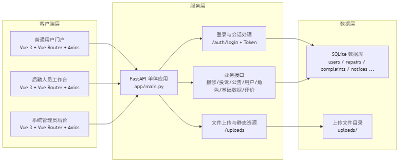

图5-1 展示了系统的总体架构。普通用户门户、后勤人员工作台和系统管理员后台共享同一套 Vue 前端代码，但在路由与菜单层进行角色分流。所有请求最终汇聚到 FastAPI 后端，由后端接口访问 SQLite 数据库或上传文件目录。漏洞版和加固版的主要区别并不是架构拓扑发生变化，而是后端在认证、授权、参数处理和上传控制方面的实现策略不同。

从功能模块设计看，系统由登录认证模块、首页概览模块、报修管理模块、投诉建议模块、公告通知模块、用户管理模块、角色管理模块、基础数据模块、评价模块和安全日志模块组成。报修、投诉和公告构成用户感知最强的业务主线；用户、角色与基础数据则为后台治理与权限组织提供基础支撑；安全日志模块虽然实现较轻，但承担了登录与操作记录的职责。

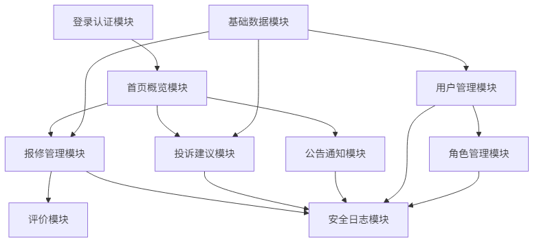

图5-2 所示的功能模块图直接对应前端视图文件和后端接口族。以报修模块为例，前端对应 `UserRepairsView.vue` 与 `RepairsView.vue`，后端对应 `/api/repairs` 系列接口；用户模块前端对应 `UsersView.vue`，后端对应 `/api/users`；基础数据模块前端对应 `AdminBaseDataView.vue`，后端对应 `/api/base-data`。模块边界与代码文件之间能够建立直接映射，这为后续系统实现章节提供了清晰的写作基础。

角色与用例关系如图5-3 所示。普通用户围绕“服务申请与进度跟踪”展开操作，后勤人员围绕“工单处理”展开操作，系统管理员围绕“全局治理”展开操作。该设计既体现了最小职责分离原则，也说明后端必须在服务端真正实现角色边界，否则仅靠前端菜单隐藏无法阻止越权。

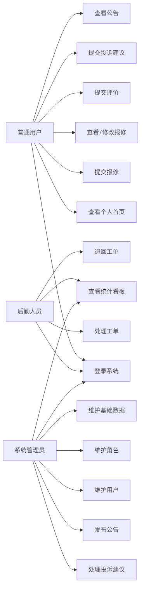

为了说明数据在系统中的流向，图5-4 给出了简化后的数据流图。用户、后勤人员与管理员均通过前端页面提交数据，前端统一调用 FastAPI 接口，后端在业务规则与状态流转逻辑中完成处理并写回数据库，最终再将处理结果返回前端页面。漏洞版的问题正是出在这里：虽然数据流表面上经过了“前端 -> 后端 -> 数据库”的完整过程，但后端并未在关键节点建立认证与授权屏障。

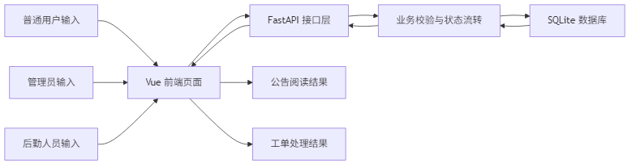

## 6 系统实现
### 6.1 前端实现
前端采用 Vue 3 单页应用结构组织页面。`App.vue` 作为根组件，`src/router/index.js` 配置系统路由。项目没有使用全局状态库，而是通过 `auth.js` 读写 `localStorage` 中的 `uniman-session` 会话对象，并在页面级组件中利用 `ref`、`reactive` 保存局部状态。这种实现路径在中小型项目中较为常见，其优点是编码直接、依赖少，缺点是如果会话对象设计不严谨，敏感数据会被直接落地到浏览器存储中。漏洞版登录页 `with-vuln/frontend/src/views/LoginView.vue` 第 77 至 80 行在调用 `setSession()` 时，将 `token`、`user` 和 `password: form.password` 一并写入本地存储；随后 `AppShell.vue` 和 `UserPortalLayout.vue` 又继续把该密码回填进界面状态中。这一设计虽然让“修改个人信息时自动带出密码”看似方便，却直接造成了明文凭据在前端持久化的问题。

前端页面结构围绕两类布局组件展开。普通用户页面使用 `UserPortalLayout.vue`，其设计重点是公告优先、服务快捷入口明显和进度信息集中展示；后台页面使用 `AppShell.vue`，其设计重点是左侧导航、顶部账号菜单和表格化管理区域。`UserHomeView.vue` 展示用户概览、公告、近期报修和投诉；`UserRepairsView.vue` 负责报修工单列表、提交、编辑、取消和评价；`UserComplaintsView.vue` 负责投诉建议提交与查看；`UserNoticesView.vue` 负责公告浏览。后台部分则由 `DashboardView.vue`、`RepairsView.vue`、`ComplaintsView.vue`、`NoticesView.vue`、`UsersView.vue`、`RolesView.vue` 与 `AdminBaseDataView.vue` 分别承担统计、工单处理与基础治理功能。页面与模块之间并非松散拼接，而是与路由和接口名称一一对应。

接口调用由 `src/api.js` 统一封装。漏洞版 Axios 实例只配置了 `baseURL: "/api"` 与超时时间，没有任何请求拦截器，因此所有请求都以“无身份上下文”的方式发出。对于普通用户首页统计接口，漏洞版 `fetchDashboard(role, userId)` 甚至要求前端显式把角色和用户编号作为查询参数传给后端，这意味着后端并不是“根据当前登录者身份生成数据”，而是在信任前端传来的角色信息。加固版则将这一设计改为由后端会话自行识别角色和用户编号，前端不再传递可伪造的身份参数。由此可见，前端接口封装方式并不仅仅是代码风格问题，而是直接影响安全边界的实现位置。

路由控制方面，`with-vuln/frontend/src/router/index.js` 使用 `beforeEach` 对 `requiresAuth`、`adminOnly` 和 `roles` 元信息进行判断。表面看，这已经完成了角色校验和页面拦截，但其实它只是一种页面级体验控制，而不是安全控制。其根本原因在于浏览器端路由守卫只能影响“页面是否跳转”，却不能阻止攻击者直接访问后端接口。项目漏洞正是建立在这种错位认知之上：前端确实隐藏了管理员入口，但后端并没有验证请求者到底是不是管理员。

### 6.2 后端实现
后端并未在目录层面拆分出独立的 Controller、Service 与 DAO 文件，而是将所有请求模型、数据库初始化、通用函数和业务接口集中到 `app/main.py` 中实现。为了保证论文描述真实，本文不将其误写成“标准三层目录架构”，而是从职责上将其分解为三个层次进行说明。第一层是接口入口层，即大量使用 `@app.get`、`@app.post`、`@app.put`、`@app.delete` 修饰的 HTTP 处理函数；第二层是业务规则层，即 `summary_metrics()`、`list_visible_notices()`、`next_order_no()`、`add_log()` 等辅助函数及接口内部的状态流转逻辑；第三层是数据访问层，即通过 `sqlite3` 执行原生 SQL 语句完成查询、插入、更新和删除。

控制入口层的特点是“按资源组织接口”。例如 `/api/repairs` 负责工单查询、创建、修改和删除，`/api/complaints` 负责投诉建议管理，`/api/notices` 负责公告查询与发布，`/api/users` 负责用户维护，`/api/roles` 负责角色维护，`/api/base-data` 负责基础数据维护，`/api/evaluations` 负责服务评价。这种实现对于功能演示非常直接，但在漏洞版中也带来了一个明显问题：接口入口层缺乏统一的认证依赖，导致任何人都可以在不知道当前会话身份的前提下直接访问或修改资源。

业务层在漏洞版中仍然具备一定业务逻辑，例如 `summary_metrics()` 会根据角色区分普通用户首页统计和后台总览统计，`list_visible_notices()` 会根据角色筛选公告范围，`next_order_no()` 会根据工单数量生成工单编号。然而，这些规则并没有被用于建立真正的服务端安全边界。以 `/api/dashboard/summary` 为例，漏洞版允许前端直接传入 `role` 和 `user_id`，后端并不校验这些参数是否与当前登录者一致。也就是说，业务逻辑存在，但并没有和认证逻辑耦合起来，从而让“谁能看到什么”退化成“前端说自己是谁就按谁来算”。

数据访问层使用最直接的 `sqlite3` 原生查询。对于大部分接口，项目使用了 `?` 占位符传参，这说明开发者并非完全不了解参数化查询。然而在最敏感的登录接口处，漏洞版却采用了字符串拼接方式构造查询语句，这一处不一致直接导致了 SQL 注入。相比之下，加固版统一采用参数化查询，并将密码校验交由 `verify_password()` 完成，安全性显著提高。

### 6.3 权限与认证实现
漏洞版登录流程从用户在前端输入用户名和密码开始，`LoginView.vue` 调用 `login(form)` 访问 `/api/auth/login`，后端在 `with-vuln/backend/app/main.py` 第 563 行附近进入登录函数，并在第 566 至 568 行拼接出查询语句。只要数据库返回任意匹配记录，系统就向前端返回形如 `vuln-token-{id}` 的字符串和完整用户信息，前端随后将 `token`、`user` 和明文密码一起写入 `localStorage`。整个流程中不存在随机 Token 签发、服务端会话表或后续接口鉴权，因此所谓 Token 实际只是一种前端路由放行标记。

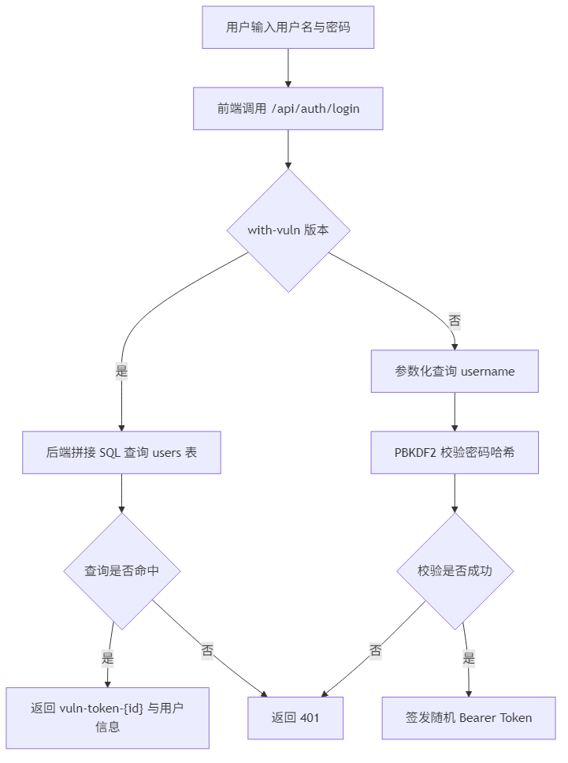

图6-1 给出了漏洞版与加固版登录流程的核心差异。漏洞版的问题不只是“登录用了 SQL”，而是“登录成功后的 Token 在服务端没有任何约束意义”。这也是为什么攻击者能够使用 SQL 注入直接拿到管理员身份并在前端顺利进入后台页面。相比之下，加固版后端引入了 `issue_token()`、`current_session()` 和 `require_roles()`。登录成功后，系统会生成随机 Token 并存入服务端 `TOKENS` 字典；后续接口通过 `Depends(current_session)` 验证 Bearer Token 是否存在且有效，再通过 `require_roles()` 判断角色是否满足要求。前端 `without-vuln/frontend/src/api.js` 也增加了请求拦截器，在每次请求中自动附加 `Authorization` 头部。

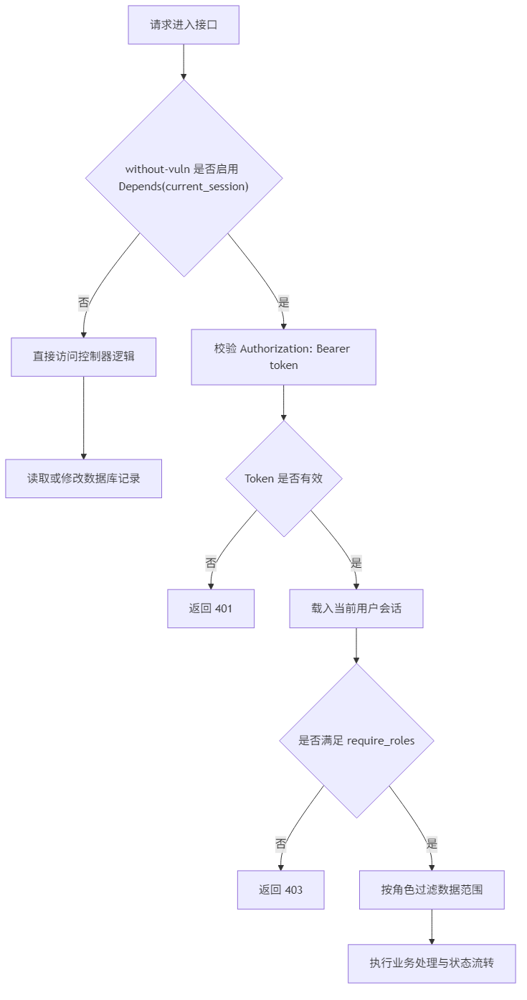

图6-2 所示的权限控制流程说明了加固版为何能阻断未授权访问。与漏洞版“接口直接进入数据库操作”不同，加固版先验证 Token，再判断角色，再按角色过滤数据范围。例如普通用户只能查看自己的工单与投诉，后勤人员只能处理分派给自己的工单，管理员才能访问用户、角色和基础数据接口。由此可见，真正的权限控制必须发生在服务端，而不能停留在前端菜单显示逻辑中。

### 6.4 数据库设计
项目数据库由 `init_db()` 函数创建，核心表包括用户表、角色表、报修表、投诉建议表、公告表、公告已读表、基础数据表、评价表和安全日志表。为了保证数据库章节基于真实实现，本文直接依据 `PRAGMA table_info` 对 SQLite 中的真实字段进行整理。表6-1 至表6-7 列出系统的核心业务表结构。

表6-1 用户表 `users`

| 字段名 | 类型 | 键约束 | 字段说明 |
| --- | --- | --- | --- |
| id | INTEGER | 主键 | 用户编号，自增 |
| username | TEXT | 唯一 | 登录账号 |
| password | TEXT | 无 | 登录密码，漏洞版为明文，加固版为哈希 |
| name | TEXT | 无 | 用户姓名 |
| role | TEXT | 无 | 角色名称，取值为普通用户、后勤人员、系统管理员 |
| phone | TEXT | 无 | 联系电话 |
| email | TEXT | 无 | 邮箱 |
| department | TEXT | 无 | 所属院系或部门 |
| status | TEXT | 无 | 账号状态 |
| created_at | TEXT | 无 | 创建时间 |

表6-2 角色表 `roles`

| 字段名 | 类型 | 键约束 | 字段说明 |
| --- | --- | --- | --- |
| id | INTEGER | 主键 | 角色编号 |
| name | TEXT | 唯一 | 角色名称 |
| code | TEXT | 无 | 角色编码 |
| description | TEXT | 无 | 角色说明 |
| permissions | TEXT | 无 | 权限描述字符串 |
| status | TEXT | 无 | 角色状态 |

表6-3 报修表 `repairs`

| 字段名 | 类型 | 键约束 | 字段说明 |
| --- | --- | --- | --- |
| id | INTEGER | 主键 | 工单编号 |
| order_no | TEXT | 无 | 工单号 |
| reporter_id | INTEGER | 外部关联用户 | 报修人编号 |
| reporter_name | TEXT | 无 | 报修人姓名 |
| repair_type | TEXT | 无 | 报修类型 |
| campus | TEXT | 无 | 校区 |
| building | TEXT | 无 | 楼栋 |
| room | TEXT | 无 | 房间号或位置 |
| description | TEXT | 无 | 问题描述 |
| contact_phone | TEXT | 无 | 联系电话 |
| image_url | TEXT | 无 | 图片地址 |
| status | TEXT | 无 | 工单状态 |
| assignee_id | INTEGER | 外部关联用户 | 处理人编号 |
| assignee_name | TEXT | 无 | 处理人姓名 |
| result | TEXT | 无 | 处理结果 |
| cancel_reason | TEXT | 无 | 取消原因 |
| cancel_source | TEXT | 无 | 取消来源 |
| created_at | TEXT | 无 | 创建时间 |
| updated_at | TEXT | 无 | 更新时间 |

表6-4 投诉建议表 `complaints`

| 字段名 | 类型 | 键约束 | 字段说明 |
| --- | --- | --- | --- |
| id | INTEGER | 主键 | 投诉编号 |
| user_id | INTEGER | 外部关联用户 | 提交人编号 |
| user_name | TEXT | 无 | 提交人姓名 |
| type | TEXT | 无 | 投诉类型 |
| title | TEXT | 无 | 标题 |
| content | TEXT | 无 | 内容 |
| image_url | TEXT | 无 | 图片地址 |
| status | TEXT | 无 | 处理状态 |
| reply | TEXT | 无 | 回复内容 |
| created_at | TEXT | 无 | 创建时间 |
| replied_at | TEXT | 无 | 回复时间 |

表6-5 公告表 `notices`

| 字段名 | 类型 | 键约束 | 字段说明 |
| --- | --- | --- | --- |
| id | INTEGER | 主键 | 公告编号 |
| title | TEXT | 无 | 公告标题 |
| content | TEXT | 无 | 公告内容 |
| status | TEXT | 无 | 公告状态，支持草稿、已发布、已下线 |
| publish_scope | TEXT | 无 | 发布范围 |
| publisher_id | INTEGER | 外部关联用户 | 发布人编号 |
| publisher_name | TEXT | 无 | 发布人姓名 |
| published_at | TEXT | 无 | 发布时间 |
| created_at | TEXT | 无 | 创建时间 |

表6-6 基础数据表 `base_data`

| 字段名 | 类型 | 键约束 | 字段说明 |
| --- | --- | --- | --- |
| id | INTEGER | 主键 | 数据编号 |
| data_type | TEXT | 无 | 数据类别，如 repair_type、campus、department |
| name | TEXT | 无 | 名称 |
| parent_name | TEXT | 无 | 上级名称 |
| status | TEXT | 无 | 状态 |
| extra | TEXT | 无 | 备注信息 |

表6-7 评价表 `evaluations`

| 字段名 | 类型 | 键约束 | 字段说明 |
| --- | --- | --- | --- |
| id | INTEGER | 主键 | 评价编号 |
| repair_id | INTEGER | 外部关联工单 | 被评价工单编号 |
| user_id | INTEGER | 外部关联用户 | 评价人编号 |
| user_name | TEXT | 无 | 评价人姓名 |
| assignee_id | INTEGER | 外部关联用户 | 被评价处理人编号 |
| assignee_name | TEXT | 无 | 被评价处理人姓名 |
| score | INTEGER | 无 | 评分 |
| comment | TEXT | 无 | 评价内容 |
| created_at | TEXT | 无 | 创建时间 |

从数据库设计可以看出，该项目的业务实体关系较为清晰。用户与报修、投诉、公告、评价之间存在一对多关系；公告与公告已读记录之间存在一对多关系；工单与评价之间存在一对多关系。图6-3 给出了根据真实表结构整理的 E-R 图。

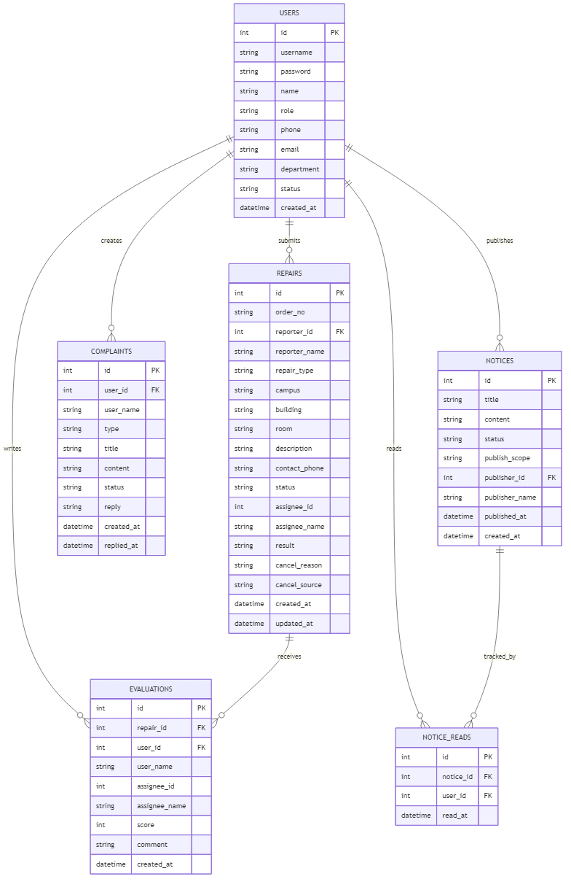

### 6.5 核心功能实现说明
报修业务是系统最重要的核心流程之一。普通用户在 `UserRepairsView.vue` 中填写报修类型、校区、楼栋、房间、问题描述与联系电话，前端调用 `createRepair(form)` 将数据发送给后端 `/api/repairs`。漏洞版后端在 `create_repair()` 中根据当前工单数量生成工单号，随后将传入的 `reporter_id`、`reporter_name`、`assignee_id`、`status` 等字段原样写入数据库。问题在于，这些字段本应由服务端根据当前会话身份和角色能力决定，但漏洞版直接信任前端提交值。加固版则在 `create_repair()` 中根据当前会话身份确定报修人，且只有管理员可显式指定处理人，从源头上收回了业务控制权。

投诉建议流程体现了前台与后台协同的另一条业务主线。普通用户在 `UserComplaintsView.vue` 中提交投诉建议，管理员在 `ComplaintsView.vue` 中查看并回复。漏洞版虽然完成了“提交”和“回复”的功能闭环，但在 `/api/complaints` 与 `/api/complaints/{id}` 上没有建立服务端角色边界，因此攻击者可以直接读取或修改全部投诉记录。加固版将普通用户、后勤人员和管理员三类访问行为区分开来，只有管理员可以统一处理投诉，普通用户只能查看或修改自己的记录。

公告模块实现了信息发布和分范围可见机制。`NoticePayload` 中包含标题、内容、状态、发布范围、发布人编号和发布人姓名等字段；普通用户页面通过 `fetchUserNotices()` 获取与自己角色匹配且状态为“已发布”的公告，管理员页面则可以管理全部公告记录。漏洞版公告接口的关键缺陷在于服务端未鉴权，任何人都能直接向 `/api/notices` 发送 POST 请求创建已发布公告。加固版将发布人信息改为从当前会话中读取，并用 `require_roles("系统管理员")` 限制公告管理接口，仅允许管理员调用。

用户管理、角色管理和基础数据管理功能主要服务于后台治理。`UsersView.vue` 中可以直接查看账号、手机号、部门和密码，漏洞版甚至在列表中直接展示明文密码字段；`RolesView.vue` 维护角色名称、编码与权限描述；`AdminBaseDataView.vue` 维护报修类型、投诉类型、校区、楼栋和部门等配置项。这些功能在实现层面都属于典型的增删改查，但正因为“表结构清晰、接口简单”，才更容易出现开发者误以为“前端能看到就是有权限”的问题。

## 7 漏洞分析与利用
### 7.1 身份认证漏洞分析
漏洞版最严重的身份认证问题出现在登录接口。`with-vuln/backend/app/main.py` 第 563 行定义了 `login()`，第 566 至 568 行使用如下方式构造查询：

```python
query = (
    "SELECT id, username, name, role, phone, email, department, status FROM users "
    f"WHERE username = '{payload.username}' AND password = '{payload.password}'"
)
```

该实现将用户名和密码直接拼接进 SQL 语句中，导致攻击者可在用户名字段输入注释型载荷，如 `' OR 1=1 -- `，从而让 `WHERE` 子句恒为真，数据库返回首条用户记录。由于种子数据中首条用户为 `admin`，攻击者可在不知道任何真实密码的情况下直接以管理员身份登录。其危害不仅是“绕过登录”，更在于后续所有前端角色分流都会围绕这条伪造成功的管理员会话展开，导致整套后台功能对攻击者开放。

为验证该漏洞，本文向漏洞版后端发送以下请求：

```bash
curl -X POST http://127.0.0.1:8000/api/auth/login ^
  -H "Content-Type: application/json" ^
  -d "{\"username\":\"' OR 1=1 -- \",\"password\":\"x\"}"
```

服务器返回结果为登录成功，并返回 `token: vuln-token-1` 与管理员用户信息。Playwright 自动化在登录页输入该载荷后成功进入管理员看板，截图见图7-1 与图7-2。

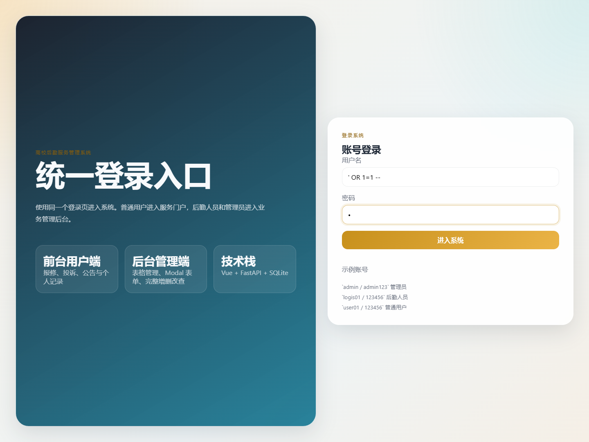

图7-1 中用户名输入框已经填入 SQL 注入载荷，密码随意填写。系统并不会对特殊字符进行任何过滤或转义，而是将该输入直接传给后端。

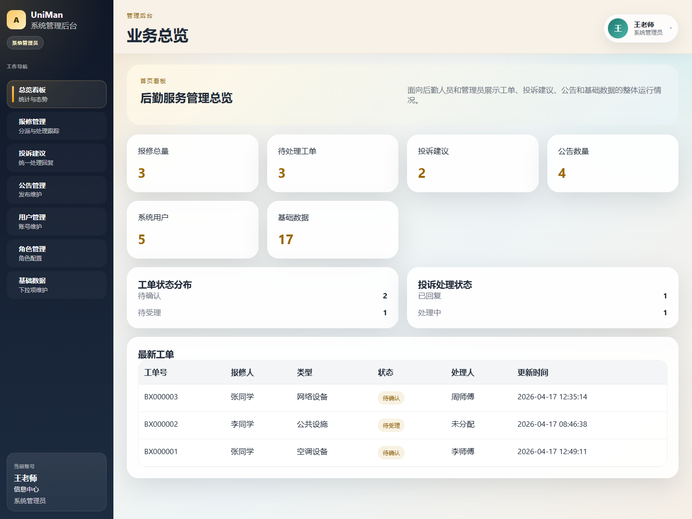

图7-2 表明登录请求成功后，前端已经跳转到管理员后台首页。由于前端把返回的用户对象保存为当前会话，路由守卫将其视为真实管理员身份，从而完成完整登录绕过。

加固版对同一载荷进行验证时，服务器返回“用户名或密码错误”。其原因在于 `without-vuln/backend/app/main.py` 第 636 行开始的登录实现使用参数化查询获取用户，并在第 646 行使用 `verify_password()` 校验哈希密码，从根本上阻断了 SQL 注入与明文密码比较两类问题。

### 7.2 敏感信息泄露与未鉴权接口
漏洞版存在大量未鉴权接口，其中最敏感的是用户列表接口。`with-vuln/backend/app/main.py` 第 898 行定义了 `@app.get("/api/users")`，其查询语句第 904 行直接返回 `password` 字段：

```python
SELECT id, username, password, name, role, phone, email, department, status, created_at
FROM users ORDER BY id ASC
```

由于该接口没有任何认证依赖，攻击者无需登录即可请求全部用户信息，且密码为明文。本文在浏览器中直接访问 `http://127.0.0.1:8000/api/users`，得到包含管理员、后勤人员和普通用户全部账号与密码的 JSON 结果，见图7-3 与图7-4。

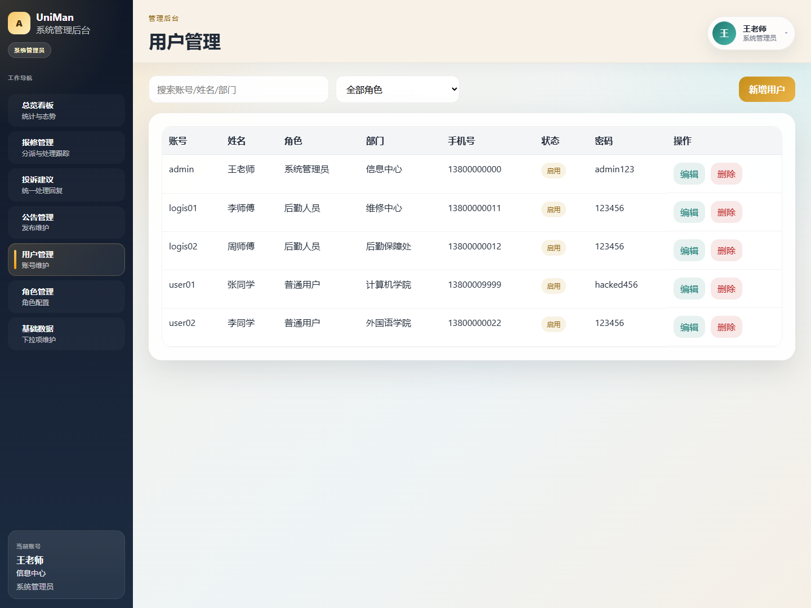

图7-3 显示的是通过登录绕过进入后台后访问用户管理页面的结果。页面中直接列出了每个账号的密码字段，说明敏感凭据不仅在数据库中明文存储，而且被后台页面原样输出。

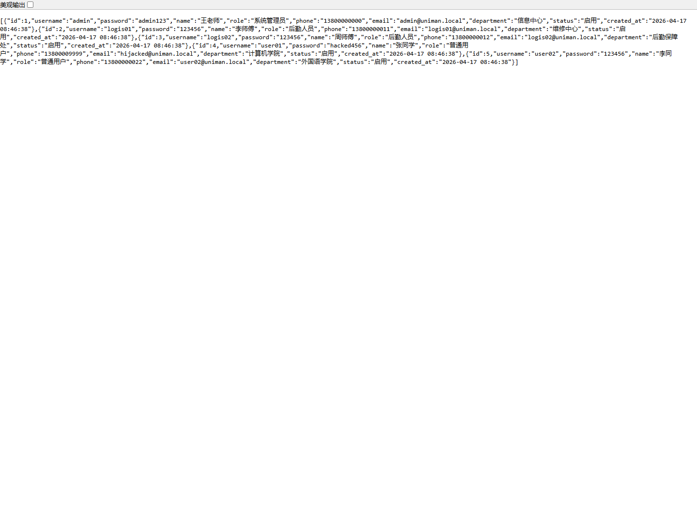

图7-4 进一步证明，即使不经过后台页面，直接请求接口也能读到同样的敏感数据。这说明“后台页面需要登录”并不能弥补“后台接口未鉴权”的根本缺陷。

除 `/api/users` 外，漏洞版的 `/api/options`、`/api/repairs`、`/api/complaints`、`/api/notices` 等接口同样没有服务端鉴权。其危害在于攻击者既可以读取敏感业务数据，也可以进一步构造修改请求。加固版在 `without-vuln/backend/app/main.py` 中对这些接口普遍引入了 `Depends(current_session)` 或 `Depends(require_roles(...))`，从而在接口层建立统一会话校验。对加固版直接访问 `/api/users` 的测试结果为 401，说明未登录状态下已经无法获取任何敏感记录。

### 7.3 权限控制漏洞与越权访问
漏洞版的越权问题集中体现在“前端页面按角色分流，但后端接口不校验操作者身份”。以个人资料修改接口为例，`with-vuln/backend/app/main.py` 第 600 行定义了 `@app.put("/api/profile/{user_id}")`，函数体直接执行：

```python
UPDATE users
SET name = ?, phone = ?, email = ?, department = ?, password = ?
WHERE id = ?
```

接口没有读取当前会话，也不判断 `user_id` 是否属于当前登录者。攻击者只需知道目标用户编号，就可以修改其手机号、邮箱甚至密码。本文验证时先以普通用户 `user02` 登录前端，再由 Playwright 在页面上下文中直接向 `/api/profile/4` 发送 PUT 请求，将 `user01` 的密码改为 `hacked456`。随后系统成功以 `user01 / hacked456` 重新登录，说明账号接管成立。自动化报告截图见图7-5。

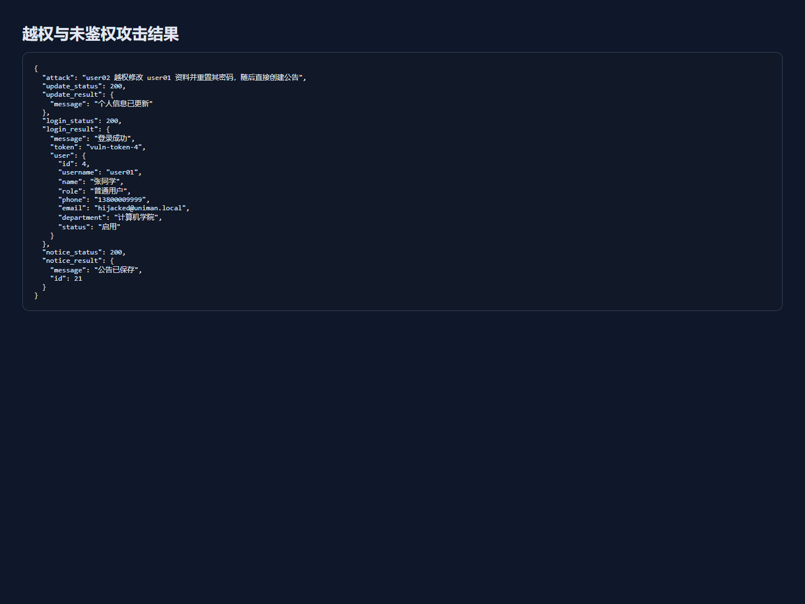

从图7-5 可以看到，越权修改接口返回 200，随后以被害人账号的新密码登录也返回 200，同时又可以继续调用公告接口创建未授权公告。这意味着越权问题已经从“修改信息”升级为“获取可持续控制权”，属于高危漏洞。

类似问题还出现在公告管理接口上。`with-vuln/backend/app/main.py` 第 835 行定义的 `@app.post("/api/notices")` 完全信任请求体中的 `publisher_id` 与 `publisher_name`，没有要求调用者必须是管理员。本文测试中直接向漏洞版接口发送以下请求：

```bash
curl -X POST http://127.0.0.1:8000/api/notices ^
  -H "Content-Type: application/json" ^
  -d "{\"title\":\"未授权公告\",\"content\":\"普通攻击者直接写入公告。\",\"status\":\"已发布\",\"publish_scope\":\"全校\",\"publisher_id\":4,\"publisher_name\":\"张同学\"}"
```

返回结果为“公告已保存”，说明任何调用者都可以绕过后台页面限制直接发布系统公告。这一问题属于典型的垂直越权。加固版则在 `create_notice()`、`update_notice()`、`delete_notice()` 上统一引入 `require_roles("系统管理员")`，并在服务端使用当前会话覆盖发布人信息，从根本上切断了伪造管理员身份的路径。

### 7.4 业务逻辑漏洞分析
除显式越权外，漏洞版还存在明显的业务逻辑缺陷。首先，工单更新接口 `@app.put("/api/repairs/{repair_id}")` 会直接用请求体中的 `status`、`assignee_id`、`assignee_name`、`result` 和 `cancel_source` 覆盖数据库记录，后端完全不校验当前操作者身份，也不校验状态流转是否合法。本文在未登录状态下直接把工单 2 从“待受理”改成“已完成”，并伪造处理结果为“攻击者伪造完成”，系统返回“报修工单已更新”。这说明攻击者不仅能读业务数据，还能伪造业务完成态，从而破坏工单真实性。

其次，评价接口 `@app.post("/api/evaluations")` 在漏洞版中只检查“同一用户是否已评价过同一工单”，并不检查该工单是否属于当前用户、是否已经完成，也不校验评价人与会话身份一致。本文实测中可直接为并不属于自己的工单提交评价，服务器返回“评价提交成功”。该缺陷虽然表面上看只是“多写了一条评价”，但在真实业务环境中会影响服务质量统计、考核结果甚至纠纷判断，因此属于典型的业务完整性漏洞。

加固版在这些方面均进行了重写。工单更新接口根据当前角色限制不同状态流转，例如普通用户只能在特定状态下编辑或撤回，后勤人员只能处理分派给自己的工单，管理员才拥有全局修改权；评价接口则要求评价人必须是工单报修人，且工单状态必须为“已完成”。这说明业务逻辑漏洞的修复不仅是“加一层 if 判断”，而是要把状态机与操作者身份绑定起来。

### 7.5 配置安全问题分析
漏洞版配置层面的第一个问题是 CORS 过宽。`with-vuln/backend/app/main.py` 第 26 行设置 `allow_origins=["*"]`，并同时允许全部方法与全部请求头。对于一个包含账号、工单、投诉和公告接口的管理系统而言，这种配置显然过于宽松，会放大跨站读取与接口滥用风险。第二个问题是文件上传接口缺少类型和大小限制。`/api/upload` 在第 558 行直接将上传内容写入磁盘，只依据原始文件后缀生成目标文件名，没有判断文件类型、大小和恶意脚本内容。这虽然不必然构成远程代码执行，但足以构成资源滥用和不安全文件托管问题。

需要说明的是，本文也对 XSS 和 CSRF 进行了审计。通过对漏洞版前端源代码搜索 `v-html`、`innerHTML`、`dangerouslySetInnerHTML` 等危险渲染点，未发现直接 HTML 注入 sink；同时使用包含 `<script>` 标签的输入进行渲染测试时，页面以普通文本方式显示载荷，未形成脚本执行链。因此，在当前代码基线下，XSS 风险主要停留在“潜在输入污染”，尚未发展为“已验证脚本执行”。类似地，由于漏洞版的大量关键接口本来就不需要登录即可直接访问，经典“借助受害者 Cookie 自动附带”的 CSRF 攻击并不是主导风险，真正的问题在于接口根本没有建立服务端认证边界。论文写作中对此应如实说明，而不能为了凑齐漏洞类型而虚构成功利用。

## 8 安全加固设计
### 8.1 认证机制加固
加固版首先修复的是登录链路。`without-vuln/backend/app/main.py` 第 154 行和第 160 行分别定义了 `hash_password()` 与 `verify_password()`，使用 PBKDF2-SHA256 结合随机盐对密码进行哈希存储与校验，从而避免明文密码进入数据库。登录时，系统先通过参数化查询按用户名取出记录，再由 `verify_password()` 校验密码哈希，第 173 行的 `issue_token()` 用于签发随机 Token，第 179 行的 `current_session()` 用于从 `Authorization` 头部读取并验证 Token。这样一来，登录接口即使被暴露到公网，也不再存在字符串拼接注入和明文密码比较问题。

在前端侧，加固版 `without-vuln/frontend/src/api.js` 第 10 至 15 行增加了 Axios 请求拦截器，统一从 `getToken()` 获取 Token 并附加到 `Authorization` 头部。会话对象中不再保存明文密码，个人中心页面也将“修改资料”与“修改密码”分离为两个独立弹窗，只有修改密码接口才需要传入当前密码和新密码。这样既避免了明文密码常驻浏览器存储，也使得密码修改流程更符合真实系统的安全预期。

### 8.2 权限控制加固
针对未鉴权与越权问题，加固版的核心设计思路是“所有资源接口默认先过会话，再过角色，再过数据范围”。`require_roles()` 负责声明哪些接口仅允许系统管理员访问，例如用户、角色、基础数据和公告管理接口；而普通用户与后勤人员共享的接口则通过 `current_session()` 获取当前用户身份，再在函数内部根据 `session["role"]` 与 `session["id"]` 限制可读可写数据范围。例如工单列表接口会根据角色分别返回“本人提交的工单”“分派给本人的工单”或“所有工单”，从而避免前端再以查询参数伪造身份。

越权修改个人资料的问题在加固版中通过显式身份校验修复。`update_profile()` 会先判断当前会话用户编号是否等于目标用户编号，或当前角色是否为管理员；否则直接返回 403。公告发布接口则不再信任请求体中的发布人编号与姓名，而是始终以当前会话中的 `session["id"]` 和 `session["name"]` 作为发布人字段。这样即使攻击者伪造请求体，也无法越权创建管理员公告。

### 8.3 业务逻辑与输入约束加固
工单状态流转是加固版业务层改造最明显的部分。漏洞版允许任意状态任意跳转，而加固版在 `update_repair()` 中针对普通用户、后勤人员和管理员分别设计了不同的状态机。普通用户只能编辑待受理工单，或在限定状态下撤回；后勤人员只能确认自己被分派的工单、提交处理结果或将工单退回待受理；管理员拥有全局修改权，但仍需遵守处理人有效性与报修人有效性检查。由此可见，真正安全的业务系统不能只依赖“前端按钮是否显示”，而必须把按钮背后的状态约束固化在服务端。

评价逻辑的修复也遵循同样思路。加固版会先确认当前用户角色是普通用户，再查询被评价工单是否存在、是否属于当前用户、是否处于“已完成”状态，最后才允许写入评价记录。这样既阻断了伪造他人评价，也避免了对未完成工单进行虚假打分，从而维护了业务数据的真实性。

### 8.4 配置与上传安全加固
针对配置安全问题，加固版显著收紧了 CORS 策略。`allow_origins` 被限定为本地前端地址 `http://localhost:5173` 和 `http://127.0.0.1:5173`，允许的方法和请求头也被明确列举为 `GET`、`POST`、`PUT`、`DELETE`、`OPTIONS` 以及 `Authorization`、`Content-Type`。这种写法虽然仍然简单，但已经比“全部放开”更符合最小授权原则。

上传接口方面，加固版在第 623 行定义允许后缀集合，仅支持 `.png`、`.jpg`、`.jpeg`、`.webp`，同时限制文件大小不超过 2MB。尽管这还不足以构成企业级文件安全方案，但对于本科毕业设计系统而言，已经完成了从“无约束上传”到“有限制上传”的关键安全跃迁。若后续继续完善，还应补充 MIME 类型检查、病毒扫描与文件访问权限控制。

### 8.5 修复效果对照
在实际验证中，加固版对漏洞版的高危利用链均给出明确阻断。未经认证直接访问 `/api/users` 返回 401；使用 SQL 注入载荷登录返回“用户名或密码错误”；普通用户试图修改他人资料时返回 403；未登录调用公告接口返回 401。由此可见，加固版并非只是在文档中宣称“已修复”，而是通过代码层面的参数化查询、身份校验、角色限制和数据范围约束，将原本可稳定复现的攻击路径实质性切断。

## 9 系统测试
系统测试分为功能测试、安全测试与对照测试三部分。测试环境为 Windows 开发环境，Python 3.11、Node.js 22、npm 10，后端使用 Uvicorn 启动 FastAPI，前端使用 Vite 启动开发服务器，数据库为 SQLite 文件。安全验证过程中，漏洞版后端运行在 8000 端口，加固版后端运行在 8001 端口，漏洞版前端运行在 5175 端口。浏览器自动化由 Playwright 完成，脚本文件为 `doc/scripts/security_capture.js`，截图输出目录为 `doc/images/security`。

从黑盒测试角度看，系统的核心用户功能均可完成闭环。普通用户能够登录、查看首页概览、提交报修、编辑未结束工单、提交投诉建议和查看公告；后勤人员能够查看看板、处理自己负责的工单并提交结果；系统管理员能够维护用户、角色、基础数据和公告。白盒测试则主要围绕路由守卫、接口参数、数据库写入逻辑和状态流转分支展开。安全测试则重点覆盖登录 SQL 注入、未鉴权接口、越权修改、业务状态伪造和上传限制对照。

表9-1 系统测试环境

| 测试项 | 环境说明 |
| --- | --- |
| 操作系统 | Windows 开发环境 |
| Python 版本 | 3.11.0 |
| Node.js 版本 | 22.0.0 |
| 前端框架 | Vue 3 + Vite |
| 后端框架 | FastAPI |
| 数据库 | SQLite |
| 自动化工具 | Playwright |

表9-2 功能与安全测试用例

| 编号 | 测试名称 | 测试方法 | 预期结果 | 实际结果 |
| --- | --- | --- | --- | --- |
| T01 | 管理员正常登录 | 黑盒测试 | 输入 `admin/admin123` 成功进入后台 | 通过 |
| T02 | 普通用户正常报修 | 黑盒测试 | 创建工单并在列表中查看 | 通过 |
| T03 | 后勤人员处理工单 | 黑盒测试 | 工单状态从已分派变为处理中或待确认 | 通过 |
| T04 | 管理员发布公告 | 黑盒测试 | 公告创建成功并可在用户端查看 | 通过 |
| T05 | 登录 SQL 注入 | 渗透测试 | 漏洞版应被绕过；加固版应阻断 | 漏洞版通过利用，加固版阻断 |
| T06 | 未鉴权读取用户表 | 渗透测试 | 漏洞版返回敏感数据；加固版返回 401 | 漏洞版成功，加固版阻断 |
| T07 | 越权修改他人资料 | 渗透测试 | 漏洞版允许；加固版返回 403 | 漏洞版成功，加固版阻断 |
| T08 | 未授权创建公告 | 渗透测试 | 漏洞版允许；加固版返回 401/403 | 漏洞版成功，加固版阻断 |
| T09 | 伪造工单状态完成 | 白盒 + 渗透测试 | 漏洞版可直接写入非法状态 | 通过利用 |
| T10 | XSS 载荷渲染测试 | 白盒 + 黑盒测试 | 当前代码不形成脚本执行 | 未触发执行 |

对于高危安全用例，本文同时给出请求示例与结果说明。登录 SQL 注入用例已在第 7.1 节给出，请求返回管理员身份。未鉴权读取用户表时，漏洞版直接返回所有账号与明文密码，而加固版返回 401。越权修改他人资料时，漏洞版允许普通用户重置他人密码并导致账号接管，而加固版返回“无权修改该用户信息”。这一结果说明加固版的修复并非形式化，而是体现在相同攻击路径上的行为差异。

为了保证论文中的截图来源明确，本文所有攻击场景截图均由 Playwright 自动化脚本生成，并保存在 `doc/images/security` 目录下。其中 `01-login-sqli-payload.png` 与 `02-login-bypass-dashboard.png` 对应登录绕过，`03-admin-users-passwords.png` 与 `04-unauthenticated-users-api.png` 对应敏感信息泄露与未鉴权访问，`05-privilege-escalation-report.png` 对应越权修改与未授权公告写入。图表类图片由 Mermaid 源文件渲染生成，保存在 `doc/images/diagrams` 目录下。

## 10 总结与展望
本文以 UniMan 高校后勤服务管理系统为研究对象，完成了从真实代码审计、系统实现分析、漏洞发现与验证，到安全加固对照和测试说明的完整研究过程。与模板化论文不同，本文所有结论均来自当前仓库的可运行代码：前端采用 Vue 3 + Vite，后端采用 FastAPI，数据库采用 SQLite；系统面向普通用户、后勤人员和系统管理员三类角色，围绕报修、投诉、公告、用户、角色、基础数据和评价构成完整业务链。通过对 `with-vuln` 与 `without-vuln` 的对照分析，本文证明了同一业务系统在不同安全实现策略下会产生截然不同的运行结果。

研究结果表明，该项目漏洞版的主要问题不是“功能缺失”，而是“安全边界错误下沉”。开发者把前端路由判断当作权限控制，把返回一个字符串 Token 当作会话管理，把数据库能查到结果当作登录成功，把前端传来的业务字段当作可信输入。这些做法虽然能快速完成功能，却使得 SQL 注入、未鉴权访问、越权修改、业务状态伪造和敏感信息泄露等问题集中爆发。加固版的价值在于给出了针对这些问题的现实修复方式，即参数化查询、密码哈希、服务端 Token 校验、角色依赖、数据范围控制与上传限制。通过这些改动，系统从“可演示”走向“可交付”。

后续若继续完善，该系统仍有若干可提升方向。首先，后端可以将 `main.py` 中集中实现的接口、业务规则与数据访问进一步模块化，以提高可维护性和可测试性。其次，可以引入更完整的审计日志与异常监控机制，以支撑更细粒度的安全追踪。再次，可以考虑为 SQLite 表补充更严格的外键、索引和唯一性约束，以进一步提升数据一致性。最后，虽然当前代码基线未形成可执行 XSS 漏洞，但若未来引入富文本公告或 HTML 渲染功能，则必须同步建立输出编码与内容清洗策略。总体而言，UniMan 项目已经具备较好的教学与研究价值，而本文完成的实现、验证与加固工作也为后续版本迭代奠定了明确基础。

## 11 参考文献
[1] FastAPI. Security - First Steps[EB/OL].  
[2] FastAPI. Advanced Security - HTTP Bearer[EB/OL].  
[3] Vue Router. Navigation Guards[EB/OL].  
[4] Axios. Interceptors[EB/OL].  
[5] SQLite Documentation. CREATE TABLE[EB/OL].  
[6] OWASP Foundation. OWASP Top 10:2021[EB/OL].  
[7] OWASP Foundation. SQL Injection Prevention Cheat Sheet[EB/OL].  
[8] RICHARDSON L, RUBY S. RESTful Web Services[M]. Sebastopol: O’Reilly Media, 2007.  
[9] Gamma E, Helm R, Johnson R, et al. Design Patterns: Elements of Reusable Object-Oriented Software[M]. Boston: Addison-Wesley, 1994.  
[10] Kleppmann M. Designing Data-Intensive Applications[M]. Sebastopol: O’Reilly Media, 2017.

## 12 致谢
本文能够完成，得益于项目仓库中同时保留了漏洞版与加固版两套真实实现，使系统分析、安全研究与修复对照得以在同一业务背景下展开。感谢该项目已有代码所提供的完整业务样本，也感谢在调试、验证和文档整理过程中形成的工程化工具链支持。通过本次毕业设计写作，不仅完成了一个后勤服务系统的实现分析，更重要的是进一步理解了软件工程中“功能实现”与“安全实现”之间的本质区别。未来在进行系统开发时，将更加重视服务端边界、数据最小暴露原则以及面向真实攻击面的安全设计。
